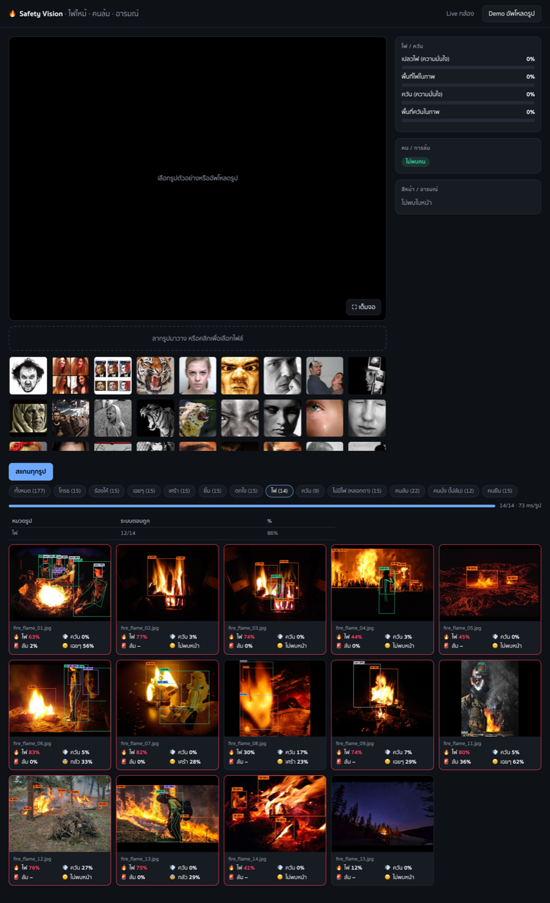
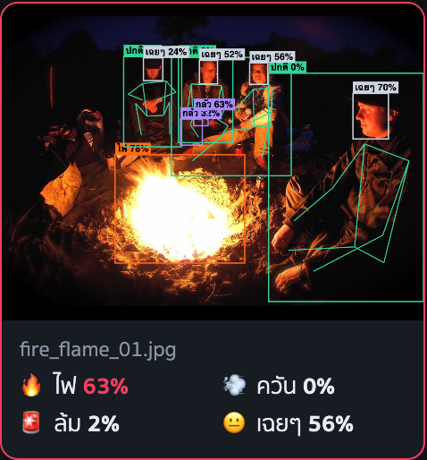

# Safety Vision

ระบบตรวจจับ **ไฟ/ควัน**, **คนล้ม** และ **อารมณ์ใบหน้า** แบบเรียลไทม์จากกล้อง เป็นเว็บแอป รันได้บน macOS, Linux, Windows และ Raspberry Pi 5 (ใช้ GPU เมื่อมี: Apple MPS หรือ NVIDIA CUDA) พร้อมหน้า Demo สำหรับสแกนรูปทดสอบเป็นชุด และแจ้งเตือนเข้า Telegram พร้อมรูป





## คุณสมบัติ

- **โหมด Live** เปิดกล้องในเบราว์เซอร์ วาดกรอบและโครงกระดูกทับภาพ แผงขวาแสดง % ไฟ ควัน โอกาสล้ม และอารมณ์
- **เตือนบนหน้าจอ**: ถ้าเจอไฟหรือคนล้มต่อเนื่อง 0.5 วินาที จะมีแบนเนอร์แดงและเสียงเตือน
- **แจ้งเตือน Telegram**: ส่งรูปพร้อมกรอบเมื่อคนล้ม ≥ 80% หรือเจอเปลวไฟ ≥ 40%
- **Fullscreen**: ปุ่มขยายเต็มจอในโหมด Live
- **โหมด Demo**: สแกนรูปตัวอย่างทั้งหมดเป็นกริด แต่ละรูปบอกเปอร์เซ็นต์ และตัวที่เกินเกณฑ์จะขึ้นสีแดง พร้อมตาราง "ระบบตอบถูก" แยกตามหมวด
- **อัพโหลดรูปของคุณเอง** ลากมาวางหรือเลือกไฟล์เพื่อทดสอบได้ทันที
- **ถ่ายภาพด้วยท่ามือ**: ชูมือครบ 5 นิ้วค้าง 5 วินาที จะนับถอยหลัง 3 วินาทีแล้วถ่ายภาพ (มีกรอบหน้า อารมณ์ โครงกระดูกตัวและมือ) แล้วโชว์ QR ที่มุมขวาล่าง 10 วินาทีให้สแกนโหลดภาพ

## โมเดลที่ใช้

ทั้งหมดเป็นโมเดลสำเร็จรูป ไม่ได้เทรนเองทั้งหมด ยกเว้นตัวจำแนกคนล้มที่เทรนจากท่าทาง

| งาน | วิธี |
|---|---|
| ไฟ/ควัน | YOLO 2 ตัว (`rabahdev/fire-smoke-yolov8n` และ `weslleyskah/fire_smoke_box`) เฉลี่ยคะแนนกัน เตือนที่ ≥ 40% |
| คนล้ม | YOLO11m-pose หา 17 จุดบนร่างกาย → ตัวจำแนก Gradient Boosting (`fall_clf.joblib`) เตือนที่ ≥ 50% บนหน้าจอ · ในโหมด Live จะติดตามแต่ละคนข้ามเฟรมและดูการทรุดลงเร็วด้วย |
| ใบหน้า/อารมณ์ | YuNet หาใบหน้า → HSEmotion `enet_b0_8_best_vgaf` (8 อารมณ์) บน CPU · "ร้องไห้" ประมาณจากเศร้าระดับสูง · โหมด Live เฉลี่ยผลข้ามเฟรมให้นิ่ง |

## ผลวัดความแม่น

| ทดสอบ | ผล |
|---|---|
| ไฟ — D-Fire 174 รูป | accuracy 0.98, precision 0.98, recall 0.93 |
| ควัน — D-Fire 174 รูป | accuracy 0.93, precision 1.00, recall 0.85 |
| เตือนผิดบนรูปหลอกตา 195 รูป (พระอาทิตย์ตก ไฟส้ม ฝุ่น) | 12% |
| คนล้ม — DeZan val 100 รูป (ไม่ได้ใช้เทรน) | accuracy 0.91, precision 0.97, recall 0.90 |
| เตือนล้มผิดบนรูปคนไม่ล้ม 105 รูป | 0 |

**ข้อควรรู้**
- ชุดทดสอบไม่ใหญ่ ตัวเลขเป็นค่าประมาณ
- โมเดลไฟบางตัวอาจเคยเห็นภาพ D-Fire ตอนเทรน ตัวเลขไฟจึงอาจสูงกว่าการใช้งานจริง
- กล้องที่มองลงจากเพดานตรงๆ หรือคนที่ตัวเล็กมากในภาพยังพลาดได้
- คนที่นอนพื้นโดยตั้งใจ (เช่นนอนเล่น) ระบบแยกไม่ได้ว่าไม่ได้ล้ม

## การติดตั้ง

### สิ่งที่ต้องมี
- macOS, Linux, Windows หรือ Raspberry Pi OS 64-bit (ทดสอบจริงบน Mac M5 16GB เท่านั้น ส่วน Windows, Linux และ Pi ยังไม่ได้ทดสอบบนเครื่องจริง)
- Python 3.12 (ตัวสคริปต์จะใช้ `uv` สร้าง venv ให้)
- [uv](https://docs.astral.sh/uv/) — macOS: `brew install uv` · Linux/Pi: `curl -LsSf https://astral.sh/uv/install.sh | sh` · Windows: `winget install astral-sh.uv`
- เว็บแคม หรือ iPhone/iPad ที่ใช้เป็นกล้องก็ได้ (ถ้าเบราว์เซอร์รองรับ)

### ขั้นตอน

**1. โหลดโค้ด**

```sh
git clone https://github.com/ShadowTak/safety-vision.git
cd safety-vision
```

**2. โมเดลและรูปตัวอย่างมาพร้อม repo แล้ว**

| ไฟล์ | หมายเหตุ |
|---|---|
| `models/fire_rabah.pt`, `models/fire_n26.pt` | โมเดลไฟ/ควัน ต้นทาง Hugging Face: `rabahdev/fire-smoke-yolov8n` และ `weslleyskah/fire_smoke_box` |
| `models/face_yunet.onnx` | ตรวจหาใบหน้า ต้นทาง OpenCV Zoo (`face_detection_yunet`) |
| `models/fall_clf.joblib` | ตัวจำแนกคนล้มที่เทรนเองจากข้อมูลท่าทาง (ดูวิธีเทรนด้านล่าง) |
| `yolo11m-pose.pt` | โมเดลท่าทางคนของ Ultralytics |
| `samples/` | รูปตัวอย่างสำหรับหน้า Demo สัญญาอนุญาตแต่ละรูปอยู่ใน `samples/SOURCES.csv` |

โมเดลอารมณ์ HSEmotion จะดาวน์โหลดอัตโนมัติผ่านแพ็กเกจ `hsemotion-onnx` ตอนรันครั้งแรก

**การเทรน `fall_clf.joblib` ใหม่ (ถ้าต้องการทำเอง)**

```sh
uv venv --python 3.12 .venv && uv pip install --python .venv/bin/python -r requirements.txt
.venv/bin/python tools/fetch_fall_data.py    # โหลดข้อมูลท่าทางคนล้มจาก Hugging Face ลง testsets/
.venv/bin/python tools/train_fall.py         # เทรนและบันทึก models/fall_clf.joblib
```

**3. รันระบบ**

```sh
./run.sh        # macOS / Linux / Raspberry Pi
run.bat         # Windows
```

ครั้งแรกสคริปต์จะสร้าง `.venv` และลง dependency ให้เอง ใช้เวลาหลายนาที เมื่อขึ้น `Uvicorn running` แล้วเปิด **http://127.0.0.1:8765** ในเบราว์เซอร์ กด `Ctrl+C` เพื่อหยุด

ถ้าพอร์ต 8765 ถูกใช้อยู่ ให้เปลี่ยนพอร์ตด้วย `PORT=9000 ./run.sh` (Windows: `set PORT=9000` แล้ว `run.bat`)

**4. (ไม่บังคับ) ตั้งค่า Telegram**

1. คุยกับ [@BotFather](https://t.me/BotFather) เพื่อสร้างบอทและรับ token
2. สร้างไฟล์ `.env` ที่รากโปรเจกต์ แล้วใส่ token
   ```
   TELEGRAM_TOKEN=123456:ABC-your-token
   ```
3. เปิดแชทกับบอทที่สร้างไว้แล้วพิมพ์ `/start` ระบบจะจำแชทนั้นไว้ในไฟล์ `.telegram_chat_id` อัตโนมัติ
   (หรือกำหนดเองด้วย `TELEGRAM_CHAT_ID=...` ใน `.env` ก็ได้)
4. รัน `./run.sh` ใหม่ ถ้าตั้งค่าครบจะขึ้น `telegram alerts: on`

ไฟล์ `.env` และ `.telegram_chat_id` อยู่ใน `.gitignore` แล้ว อย่าใส่ token ลงในโค้ดหรืออัพโหลดขึ้น GitHub

## โปรไฟล์: full (มี GPU) และ lite (CPU / Raspberry Pi 5)

โค้ดชุดเดียวกันทุกเครื่อง ระบบเลือกโปรไฟล์จากฮาร์ดแวร์ให้เอง (บังคับด้วย `SV_PROFILE=full` หรือ `lite`) ฟังก์ชันครบเหมือนกัน: ไฟ/ควัน, คนล้ม, อารมณ์, Live, Demo, Telegram

| ส่วน | full — Mac Apple Silicon (MPS), PC ที่มี NVIDIA (CUDA) | lite — Raspberry Pi 5, PC ที่ไม่มี GPU |
|---|---|---|
| รันโมเดล | PyTorch บน GPU แบบ fp16 | **NCNN** บน CPU ทุกคอร์ |
| ท่าทางคน | YOLO11**m**-pose @800 | YOLO11**s**-pose @640 (`models/yolo11s-pose_ncnn_model`) |
| ตัวจำแนกล้ม | `fall_clf.joblib` | `fall_clf_pi.joblib` (เทรนใหม่จาก keypoint ของ s-pose) |
| ไฟ/ควัน | 2 โมเดลเฉลี่ยกัน ทุก 2 เฟรม | โมเดลเดิม 2 ตัวแปลงเป็น NCNN รันทุก 3 เฟรม |
| อารมณ์ | ทุกเฟรม | ทุก 3 เฟรม |

ความแม่นของ lite (วัดบน Mac ด้วย `SV_PROFILE=lite tools/evaluate.py` ชุดทดสอบเดียวกับด้านบน): ไฟ 0.98 / ควัน 0.93 เท่าเดิม, คนล้ม DeZan accuracy 0.88 (full = 0.91), เตือนล้มผิด 0 รูป

ความเร็วต่อเฟรม (ภาพ 960×540 เปิดครบทุกโมดูล วัดบน Mac M5): full ≈ 34 ms, lite ≈ 54 ms

- **NVIDIA บน Windows**: `torch` ที่ลงจาก PyPI บน Windows เป็นแบบ CPU จึงได้โปรไฟล์ lite ถ้าต้องการใช้ GPU ให้ลง torch แบบ CUDA ทับใน `.venv` ตามคำสั่งที่ [pytorch.org](https://pytorch.org/get-started/locally/) แล้วระบบจะสลับเป็น full เอง
- **กล้อง**: เบราว์เซอร์เปิดกล้องได้เฉพาะ `localhost` หรือ HTTPS ให้เปิดเบราว์เซอร์บนตัว Pi เอง ถ้าเปิดจากเครื่องอื่น (`HOST=0.0.0.0 ./run.sh`) โหมด Demo อัพโหลดรูปใช้ได้ แต่ Live ต้องมี HTTPS
- แนะนำฮีตซิงก์/พัดลม (Active Cooler) เพราะ CPU เต็มโหลดต่อเนื่อง
- ความเร็วจริงบน Pi ยังไม่ได้วัดบนเครื่องจริง (วัดบน Mac เท่านั้น) ถ้าช้าเกินไปให้ปิดโมดูลที่ไม่ใช้ในหน้า Live
- เทรนตัวจำแนกใหม่: `tools/train_fall.py yolo11s-pose.pt models/fall_clf_pi.joblib` ส่วนการแปลงโมเดลเป็น NCNN ใช้ `YOLO(...).export(format="ncnn", imgsz=640)`

## วิธีใช้

### โหมด Live
1. แท็บ **Live กล้อง** → กด **เปิดกล้อง** → อนุญาตการเข้าถึงกล้องในเบราว์เซอร์
2. ระบบวิเคราะห์ทุกเฟรม วาดกรอบและโครงกระดูกทับภาพ
3. ติ๊ก/ปิดแต่ละโมดูลได้ (ไฟ, ล้ม, อารมณ์) ถ้าปิดที่ไม่ใช้ระบบจะเร็วขึ้น
4. กดปุ่มขยายมุมจอเพื่อดูแบบเต็มจอ

### โหมด Demo
1. แท็บ **Demo อัพโหลดรูป**
2. เลือกหมวดด้วยปุ่ม chip (ถ้าไม่เลือก ระบบจะสแกนทุกหมวด) แล้วกด **สแกนทุกรูป**
3. คลิกการ์ดรูปเพื่อดูภาพใหญ่และรายละเอียด
4. ลากรูปของคุณมาวางในกล่องอัพโหลดเพื่อทดสอบ

### ถ่ายภาพด้วยท่ามือ (โหมด Live)
1. เปิดกล้อง แล้วชูมือครบ 5 นิ้วหน้ากล้องค้างไว้ 5 วินาที (มีวงแหวนเอฟเฟกต์รอบฝ่ามือนับเวลา) ถ้ามือหายหรือกำมือ ระบบจะเริ่มนับใหม่
2. ครบแล้วนับถอยหลัง 3-2-1 และถ่ายภาพ ภาพรวมกรอบหน้า อารมณ์ โครงกระดูก และเส้นมือ กล้องทำงานต่อเนื่องไม่หยุด
3. ภาพถูกบันทึกในโฟลเดอร์ `captures/` (ไม่ขึ้น git) และอัพโหลดไป [tmpfiles.org](https://tmpfiles.org) ซึ่งลบไฟล์เองหลัง 60 นาที QR ที่ขวาล่างชี้ไปที่ลิงก์นั้น คนที่อยู่นอก Wi-Fi ก็สแกนโหลดได้
4. ต้องต่ออินเทอร์เน็ต (โมเดลตรวจมือ MediaPipe และตัวสร้าง QR โหลดจาก CDN) ถ้าอัพโหลดไม่ได้ ภาพยังอยู่ใน `captures/` และการ์ดจะแจ้งว่าไม่มี QR
5. **ความเป็นส่วนตัว**: ภาพใบหน้าจะไปอยู่บนเซิร์ฟเวอร์ภายนอกจนกว่าจะหมดอายุ ใช้เฉพาะเมื่อผู้ถูกถ่ายยินยอม

### แจ้งเตือน Telegram
- ส่งรูปพร้อมกรอบเมื่อ **คนล้ม ≥ 80%** หรือ **เปลวไฟ ≥ 40%** ต่อเนื่อง 0.5 วินาที
- ควันอย่างเดียวไม่ส่ง
- ส่งได้ไม่เกิน 1 ข้อความต่อประเภทต่อนาที เพื่อไม่ให้ข้อความท่วม · ถ้าส่งไม่สำเร็จ (เช่นเน็ตหลุด) จะลองใหม่ใน 10 วินาที
- ส่งไปแชทที่บันทึกไว้ในข้อ 4 ของการติดตั้ง
- เกณฑ์บนหน้าเว็บ (ล้ม 50%) และเกณฑ์ Telegram (ล้ม 80%) ต่างกันโดยตั้งใจ เพื่อให้หน้าจอเตือนไว แต่ Telegram ส่งเฉพาะเคสที่มั่นใจ

## โครงสร้างโปรเจกต์

| ไฟล์ | หน้าที่ |
|---|---|
| `server.py` | FastAPI: หน้าเว็บ, `POST /api/analyze` สำหรับรูป, `WS /ws/live` สำหรับกล้อง |
| `pipeline.py` | โมเดลทั้งหมด ใช้ร่วมกันระหว่าง Live และ Demo |
| `notify.py` | แจ้งเตือน Telegram พร้อมรูปที่วาดกรอบแล้ว |
| `fall_features.py` | แปลงท่าทางเป็น feature ให้ตัวจำแนกคนล้ม |
| `static/index.html` | หน้าเว็บ |
| `local_addons.py`, `local_static/capture.js` | ระบบถ่ายภาพด้วยท่ามือ (โหลดอัตโนมัติถ้ามีไฟล์) |
| `run.sh`, `run.bat` | สร้าง venv, โหลด `.env` และรันเซิร์ฟเวอร์ (`run.bat` สำหรับ Windows) |
| `tools/fetch_fall_data.py` | โหลดข้อมูลท่าทางคนล้มสำหรับเทรน |
| `tools/train_fall.py` | เทรนตัวจำแนกคนล้ม |
| `tools/evaluate.py` | วัดความแม่นของทั้งสามโมดูล |
| `tools/bench_fire.py` | เปรียบเทียบโมเดลไฟหลายตัว |
| `docs/img/` | รูปตัวอย่างในเอกสาร |

## ข้อจำกัด

- รูปหมวดใบหน้าใน `samples/` หลายรูปติดป้ายอารมณ์ไม่ตรงกับสีหน้าจริง ตาราง "ระบบตอบถูก" ของหมวดใบหน้าจึงต่ำกว่าความสามารถจริงของโมเดล
- ชุดทดสอบยังเล็ก ตัวเลขความแม่นควรใช้เป็นแนวทาง ไม่ใช่การรับประกัน
- ระบบนี้เป็นตัวช่วยเตือนเบื้องต้น ไม่ควรใช้แทนระบบความปลอดภัยที่ได้มาตรฐาน

## สัญญาอนุญาต

โค้ดในโปรเจกต์นี้ยังไม่ได้ระบุสัญญาอนุญาต โมเดลและรูปตัวอย่างมาจากแหล่งภายนอก

- รูปตัวอย่างใน `samples/` มีสัญญาอนุญาตแยกกันตามรูป ดูใน `samples/SOURCES.csv` รูปที่เป็น **NC** ห้ามใช้เชิงพาณิชย์ และรูปที่เป็น **ND** ห้ามดัดแปลงเผยแพร่ซ้ำ
- โมเดล `yolo11m-pose.pt` อยู่ภายใต้ AGPL-3.0 ของ Ultralytics
- ก่อนนำไปใช้เชิงพาณิชย์ ให้ตรวจสอบเงื่อนไขของแต่ละต้นทางก่อน
