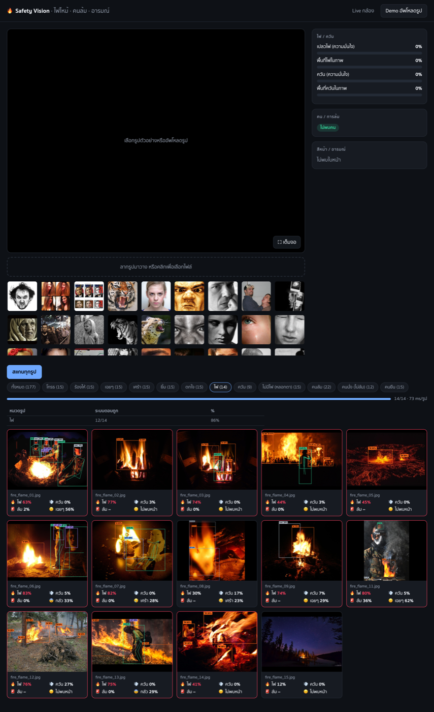
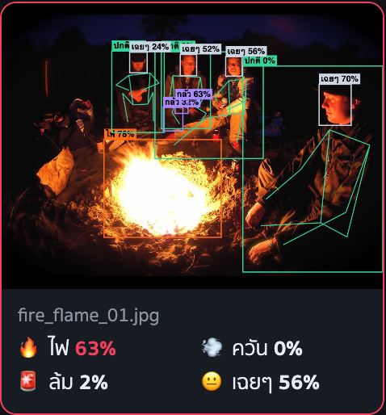

# Safety Vision

ระบบตรวจจับ **ไฟ/ควัน**, **คนล้ม** และ **อารมณ์ใบหน้า** แบบเรียลไทม์จากกล้อง เป็นเว็บแอป รันบน Mac (Apple Silicon ใช้ GPU ผ่าน MPS) พร้อมหน้า Demo สำหรับสแกนรูปทดสอบเป็นชุด และแจ้งเตือนเข้า Telegram พร้อมรูป





## คุณสมบัติ

- **โหมด Live** เปิดกล้องในเบราว์เซอร์ วาดกรอบและโครงกระดูกทับภาพ แผงขวาแสดง % ไฟ ควัน โอกาสล้ม และอารมณ์
- **เตือนบนหน้าจอ**: ถ้าเจอไฟหรือคนล้มติดกัน 2 เฟรม จะมีแบนเนอร์แดงและเสียงเตือน
- **แจ้งเตือน Telegram**: ส่งรูปพร้อมกรอบเมื่อคนล้ม ≥ 80% หรือเจอเปลวไฟ ≥ 40%
- **Fullscreen**: ปุ่มขยายเต็มจอในโหมด Live
- **โหมด Demo**: สแกนรูปตัวอย่างทั้งหมดเป็นกริด แต่ละรูปบอกเปอร์เซ็นต์ และตัวที่เกินเกณฑ์จะขึ้นสีแดง พร้อมตาราง "ระบบตอบถูก" แยกตามหมวด
- **อัพโหลดรูปของคุณเอง** ลากมาวางหรือเลือกไฟล์เพื่อทดสอบได้ทันที

## โมเดลที่ใช้

ทั้งหมดเป็นโมเดลสำเร็จรูป ไม่ได้เทรนเองทั้งหมด ยกเว้นตัวจำแนกคนล้มที่เทรนจากท่าทาง

| งาน | วิธี |
|---|---|
| ไฟ/ควัน | YOLO 2 ตัว (`rabahdev/fire-smoke-yolov8n` และ `weslleyskah/fire_smoke_box`) เฉลี่ยคะแนนกัน เตือนที่ ≥ 40% |
| คนล้ม | YOLO11m-pose หา 17 จุดบนร่างกาย → ตัวจำแนก Gradient Boosting (`fall_clf.joblib`) เตือนที่ ≥ 50% บนหน้าจอ · ในโหมด Live จะติดตามแต่ละคนข้ามเฟรมและดูการทรุดลงเร็วด้วย |
| ใบหน้า/อารมณ์ | YuNet หาใบหน้า → HSEmotion `enet_b0_8_best_vgaf` (8 อารมณ์) บน CPU · "ร้องไห้" ประมาณจากเศร้าระดับสูง · โหมด Live เฉลี่ยผลข้ามเฟรมให้นิ่ง |

## ผลวัดความแม่น

| ทดสอบ | ผล |
|---|---|
| ไฟ — D-Fire 174 รูป | accuracy 0.98, precision 0.98, recall 0.93 |
| ควัน — D-Fire 174 รูป | accuracy 0.93, precision 1.00, recall 0.85 |
| เตือนผิดบนรูปหลอกตา 195 รูป (พระอาทิตย์ตก ไฟส้ม ฝุ่น) | 12% |
| คนล้ม — DeZan val 100 รูป (ไม่ได้ใช้เทรน) | accuracy 0.92, precision 0.97, recall 0.91 |
| เตือนล้มผิดบนรูปคนไม่ล้ม 105 รูป | 0 |

**ข้อควรรู้**
- ชุดทดสอบไม่ใหญ่ ตัวเลขเป็นค่าประมาณ
- โมเดลไฟบางตัวอาจเคยเห็นภาพ D-Fire ตอนเทรน ตัวเลขไฟจึงอาจสูงกว่าการใช้งานจริง
- กล้องที่มองลงจากเพดานตรงๆ หรือคนที่ตัวเล็กมากในภาพยังพลาดได้
- คนที่นอนพื้นโดยตั้งใจ (เช่นนอนเล่น) ระบบแยกไม่ได้ว่าไม่ได้ล้ม

## การติดตั้ง

### สิ่งที่ต้องมี
- macOS บน Apple Silicon (ทดสอบบน M5, 16GB)
- Python 3.12 (ตัวสคริปต์จะใช้ `uv` สร้าง venv ให้)
- [uv](https://docs.astral.sh/uv/) — ติดตั้งด้วย `brew install uv`
- เว็บแคม หรือ iPhone/iPad ที่ใช้เป็นกล้องก็ได้ (ถ้าเบราว์เซอร์รองรับ)

### ขั้นตอน

**1. โหลดโค้ด**

```sh
git clone https://github.com/ShadowTak/safety-vision.git
cd safety-vision
```

**2. วางโมเดลที่ไม่ได้มาใน repo**

ไฟล์โมเดลและรูปตัวอย่างไม่ได้อยู่ใน repo เพราะสัญญาอนุญาตของแต่ละชุดไม่เหมือนกัน ให้วางไว้ในโฟลเดอร์ `models/` ตามชื่อนี้

| ไฟล์ | ได้มาจาก |
|---|---|
| `models/fire_rabah.pt` | Hugging Face: `rabahdev/fire-smoke-yolov8n` |
| `models/fire_n26.pt` | Hugging Face: `weslleyskah/fire_smoke_box` (YOLO26n) |
| `models/face_yunet.onnx` | OpenCV Zoo: `models/face_detection_yunet` (เปลี่ยนชื่อเป็น `face_yunet.onnx`) |
| `models/fall_clf.joblib` | เทรนเองด้วย `tools/train_fall.py` (ดูหัวข้อด้านล่าง) |
| `yolo11m-pose.pt` (ที่รากโปรเจกต์) | ดาวน์โหลดอัตโนมัติจาก Ultralytics ตอนรันครั้งแรก |
| โมเดลอารมณ์ HSEmotion | ดาวน์โหลดอัตโนมัติผ่านแพ็กเกจ `hsemotion-onnx` ตอนรันครั้งแรก |

ตัวอย่างที่ต้องการให้ระบบทำงานบนรูปของคุณเอง ไม่ต้องมีรูปใน `samples/` ก็ได้ แต่หน้า Demo จะว่างเปล่า

**การเทรน `fall_clf.joblib` (ถ้าต้องการทำเอง)**

```sh
uv venv --python 3.12 .venv && uv pip install --python .venv/bin/python -r requirements.txt
.venv/bin/python tools/fetch_fall_data.py    # โหลดข้อมูลท่าทางคนล้มจาก Hugging Face ลง testsets/
.venv/bin/python tools/train_fall.py         # เทรนและบันทึก models/fall_clf.joblib
```

**3. รันระบบ**

```sh
./run.sh
```

ครั้งแรกสคริปต์จะสร้าง `.venv` และลง dependency ให้เอง ใช้เวลาหลายนาที เมื่อขึ้น `Uvicorn running` แล้วเปิด **http://127.0.0.1:8765** ในเบราว์เซอร์ กด `Ctrl+C` เพื่อหยุด

ถ้าพอร์ต 8765 ถูกใช้อยู่ ให้เปลี่ยนพอร์ตด้วย `PORT=9000 ./run.sh`

**4. (ไม่บังคับ) ตั้งค่า Telegram**

1. คุยกับ [@BotFather](https://t.me/BotFather) เพื่อสร้างบอทและรับ token
2. สร้างไฟล์ `.env` ที่รากโปรเจกต์ แล้วใส่ token
   ```
   TELEGRAM_TOKEN=123456:ABC-your-token
   ```
3. เปิดแชทกับบอทที่สร้างไว้แล้วพิมพ์ `/start` ระบบจะจำแชทนั้นไว้ในไฟล์ `.telegram_chat_id` อัตโนมัติ
   (หรือกำหนดเองด้วย `TELEGRAM_CHAT_ID=...` ใน `.env` ก็ได้)
4. รัน `./run.sh` ใหม่ ถ้าตั้งค่าครบจะขึ้น `telegram alerts: on`

ไฟล์ `.env` และ `.telegram_chat_id` อยู่ใน `.gitignore` แล้ว อย่าใส่ token ลงในโค้ดหรืออัพโหลดขึ้น GitHub

## วิธีใช้

### โหมด Live
1. แท็บ **Live กล้อง** → กด **เปิดกล้อง** → อนุญาตการเข้าถึงกล้องในเบราว์เซอร์
2. ระบบวิเคราะห์ทุกเฟรม วาดกรอบและโครงกระดูกทับภาพ
3. ติ๊ก/ปิดแต่ละโมดูลได้ (ไฟ, ล้ม, อารมณ์) ถ้าปิดที่ไม่ใช้ระบบจะเร็วขึ้น
4. กดปุ่มขยายมุมจอเพื่อดูแบบเต็มจอ

### โหมด Demo
1. แท็บ **Demo อัพโหลดรูป**
2. เลือกหมวดด้วยปุ่ม chip (ถ้าไม่เลือก ระบบจะสแกนทุกหมวด) แล้วกด **สแกนทุกรูป**
3. คลิกการ์ดรูปเพื่อดูภาพใหญ่และรายละเอียด
4. ลากรูปของคุณมาวางในกล่องอัพโหลดเพื่อทดสอบ

### แจ้งเตือน Telegram
- ส่งรูปพร้อมกรอบเมื่อ **คนล้ม ≥ 80%** หรือ **เปลวไฟ ≥ 40%** ติดกัน 2 เฟรม
- ควันอย่างเดียวไม่ส่ง
- ส่งได้ไม่เกิน 1 ข้อความต่อประเภทต่อนาที เพื่อไม่ให้ข้อความท่วม
- ส่งไปแชทที่บันทึกไว้ในข้อ 4 ของการติดตั้ง
- เกณฑ์บนหน้าเว็บ (ล้ม 50%) และเกณฑ์ Telegram (ล้ม 80%) ต่างกันโดยตั้งใจ เพื่อให้หน้าจอเตือนไว แต่ Telegram ส่งเฉพาะเคสที่มั่นใจ

## โครงสร้างโปรเจกต์

| ไฟล์ | หน้าที่ |
|---|---|
| `server.py` | FastAPI: หน้าเว็บ, `POST /api/analyze` สำหรับรูป, `WS /ws/live` สำหรับกล้อง |
| `pipeline.py` | โมเดลทั้งหมด ใช้ร่วมกันระหว่าง Live และ Demo |
| `notify.py` | แจ้งเตือน Telegram พร้อมรูปที่วาดกรอบแล้ว |
| `fall_features.py` | แปลงท่าทางเป็น feature ให้ตัวจำแนกคนล้ม |
| `static/index.html` | หน้าเว็บ |
| `run.sh` | สร้าง venv, โหลด `.env` และรันเซิร์ฟเวอร์ |
| `tools/fetch_fall_data.py` | โหลดข้อมูลท่าทางคนล้มสำหรับเทรน |
| `tools/train_fall.py` | เทรนตัวจำแนกคนล้ม |
| `tools/evaluate.py` | วัดความแม่นของทั้งสามโมดูล |
| `tools/bench_fire.py` | เปรียบเทียบโมเดลไฟหลายตัว |
| `docs/img/` | รูปตัวอย่างในเอกสาร |

## ข้อจำกัด

- ออกแบบมาสำหรับ Mac (MPS) ถ้าไม่มี MPS ระบบจะใช้ CPU อัตโนมัติ ซึ่งช้ากว่ามาก
- ชุดทดสอบยังเล็ก ตัวเลขความแม่นควรใช้เป็นแนวทาง ไม่ใช่การรับประกัน
- ระบบนี้เป็นตัวช่วยเตือนเบื้องต้น ไม่ควรใช้แทนระบบความปลอดภัยที่ได้มาตรฐาน

## สัญญาอนุญาต

โค้ดในโปรเจกต์นี้ยังไม่ได้ระบุสัญญาอนุญาต โมเดลและชุดข้อมูลที่ใช้มาจากแหล่งภายนอกแต่ละแห่ง ให้ตรวจสอบเงื่อนไขของต้นทางก่อนนำไปใช้เชิงพาณิชย์
